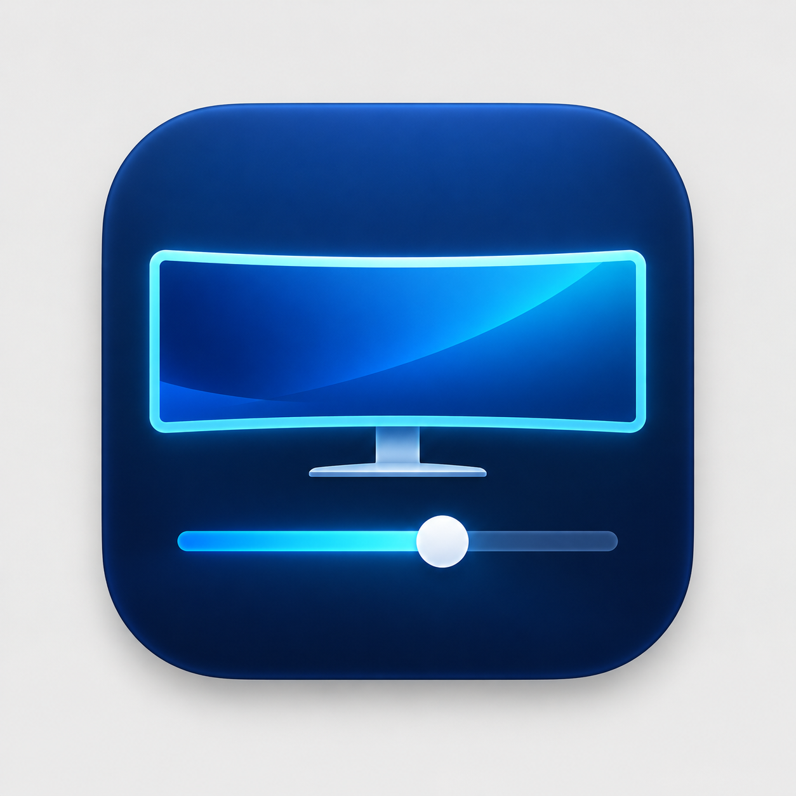
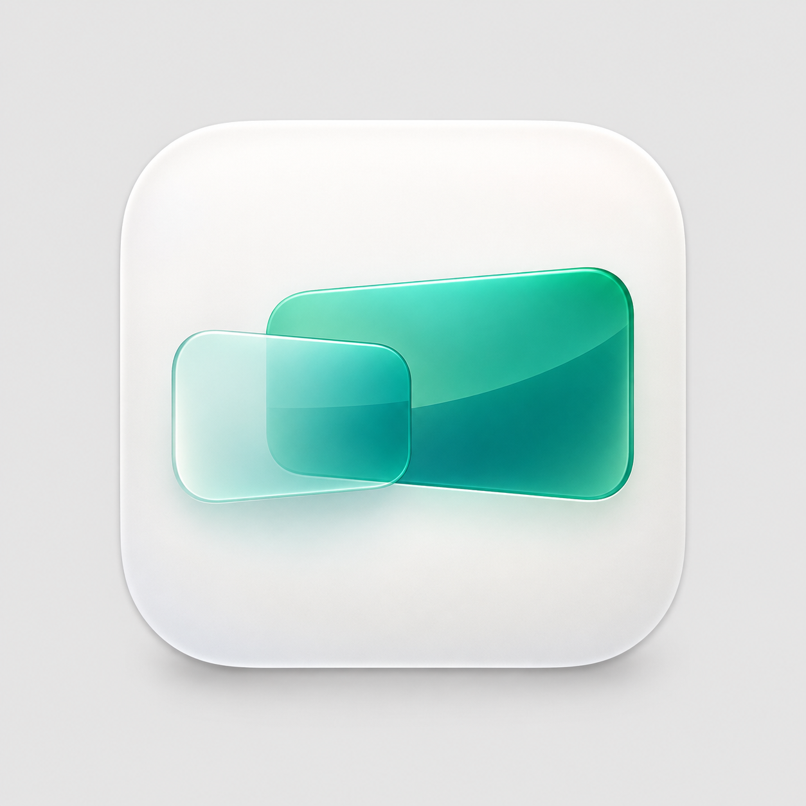
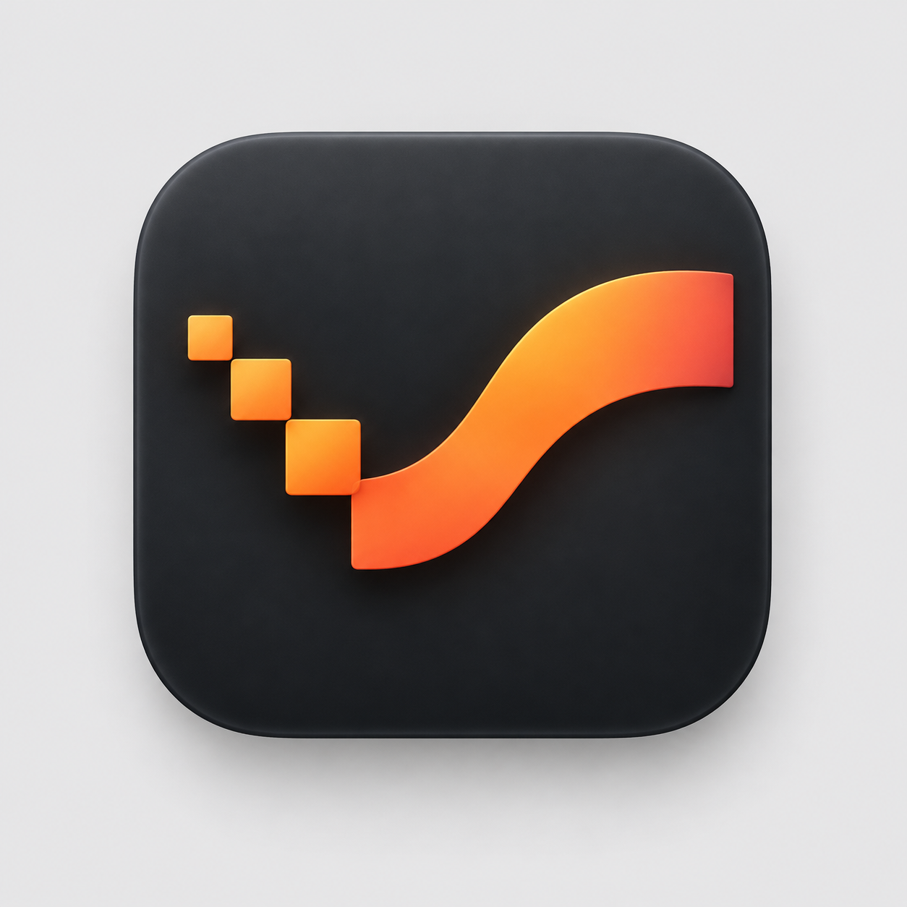

# アイコン候補

UltraScaleのアイコンを選ぶための比較用原画です。採用した緑版（バーなし）と予備の青版は、[アプリ用素材](../../Assets/Icons/README.md)に収録しています。

| A：モニタと倍率 | B：重なる画面 | C：ピクセルから曲線へ |
| --- | --- | --- |
|  |  |  |
| 機能が一目で分かる、ディスプレイ調整ツールらしい案。 | 画面の拡大縮小を表現した、明るく軽快な案。 | HiDPIによる滑らかさを抽象化した、印象の強い案。 |

機能の伝わりやすさならA、軽さと簡潔さならB、独自性ならCを想定しています。

## 画像の扱い

これらはテスト出力やUIの比較スクリーンショットではなく、依頼に基づいて作成したアイコンのデザイン候補です。将来のアイコン制作・修正の入力となる原画を、採用判断と一緒に履歴管理するため、このフォルダの3枚をGitに保存します。一時的なCI artifactだけでは、採用後の原画参照や修正入力としての保存期間を確保できません。

候補画像には比較用の背景と余白が含まれています。採用案が決まった後に、背景透過、Dockでの縮小表示、`.icns` 化を調整してから組み込みます。アプリ用の採用素材と切り替え手順は、上記のアプリ用素材を参照してください。

組み込みの `image_gen` で生成しました。再生成に使った正確な入力は `prompts.json` に保存しています。外部画像は参照していません。
