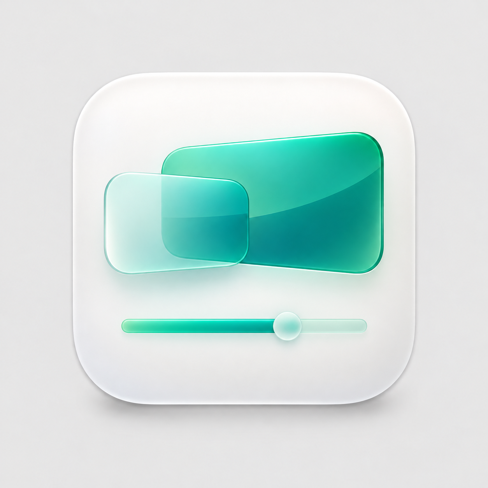
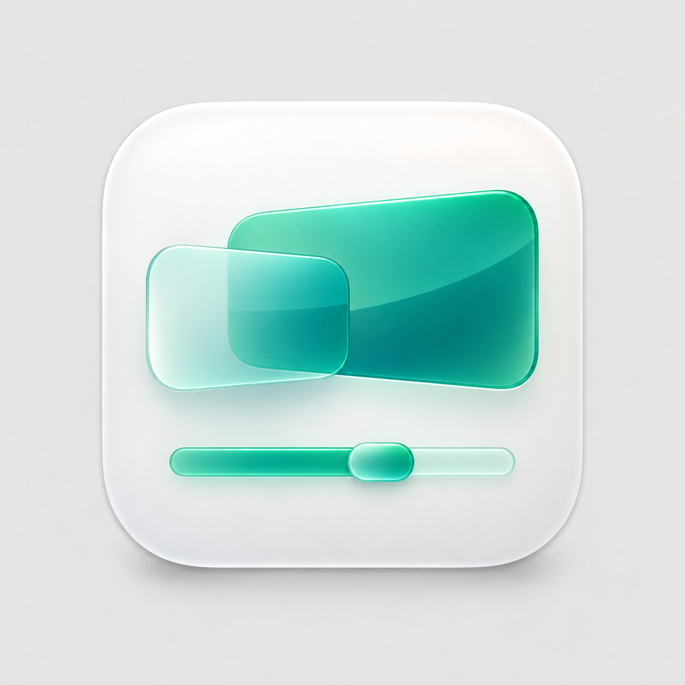
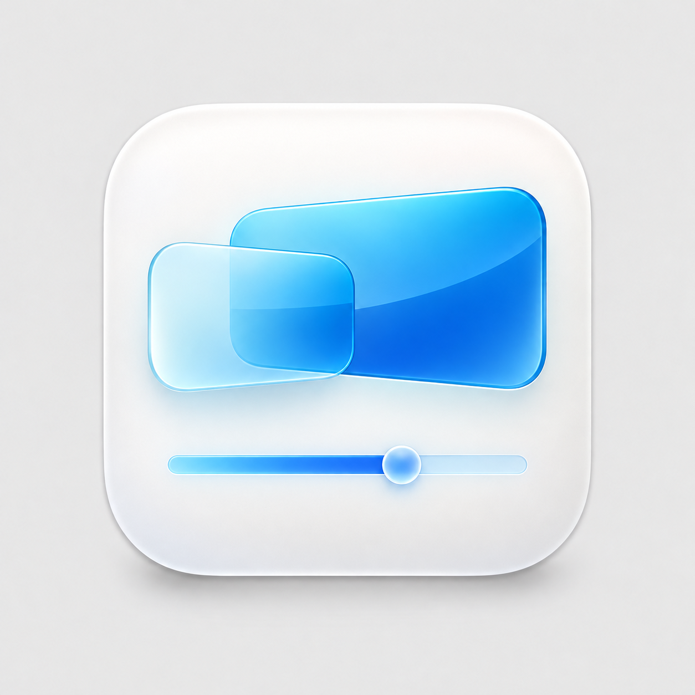
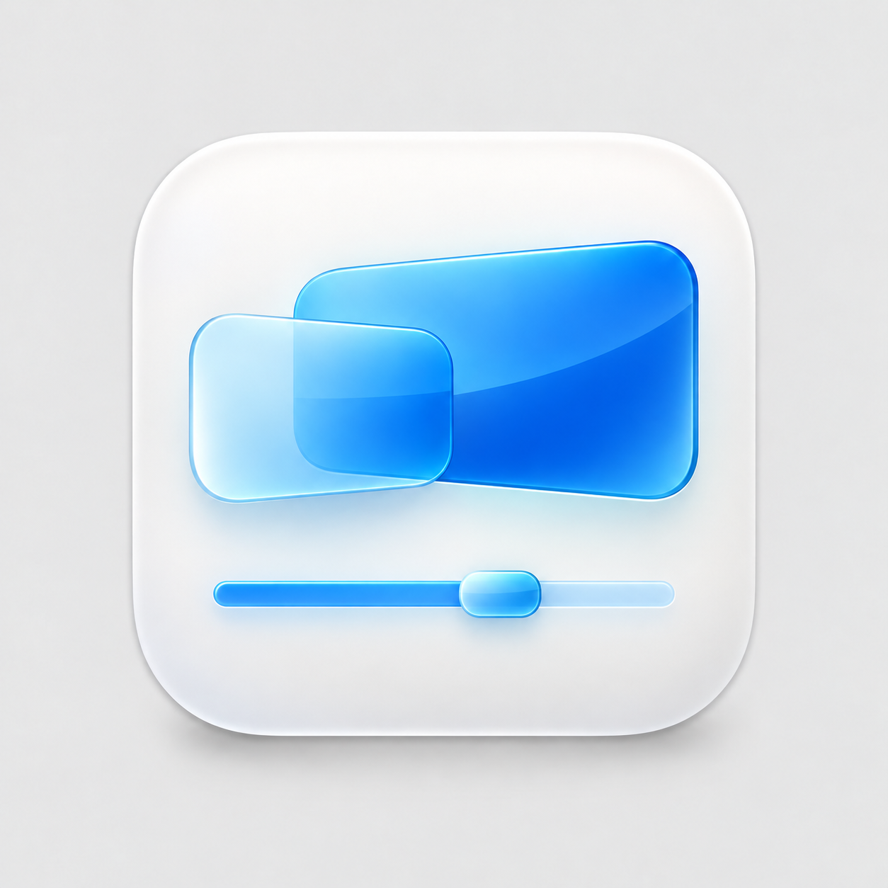

# スクリーン＋スライダーの候補

白地に半透明の画面が重なる原画を基に、画面を少し上へ移し、下へ抽象的なスライダーを配置した4案です。色とつまみの形で識別します。青・角丸のつまみを正式アイコンに採用しました。予備は別途指定されたスライダーなしの緑版で、アプリ用素材は `Assets/Icons/` に保存しています。

| 緑・丸いつまみ | 緑・角丸のつまみ |
| --- | --- |
|  |  |

| 青・丸いつまみ | 青・角丸のつまみ |
| --- | --- |
|  |  |

丸いつまみは操作部としての分かりやすさ、角丸のつまみはスクリーンとの形の統一感を重視した案です。

これらは依頼されたデザイン候補の原画であり、テスト画像ではありません。将来の採用・修正の入力として使うため、原画と生成プロンプトを継続的にGit管理します。保存期間が限られるCI artifactだけでは原画の継続利用に適しません。組み込み image_genで添付原画を編集し、正確な生成入力を `prompts.json` に保存しています。
